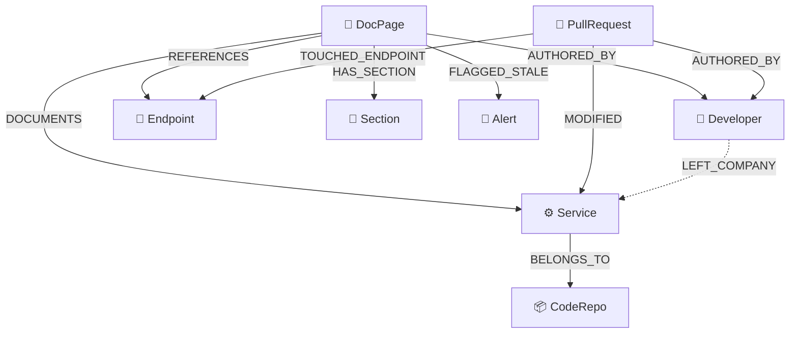
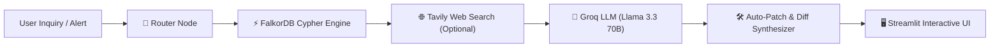

# 🛰️ DocuDrift / LivingWiki — Autonomous Knowledge Staleness & Drift Sentinel

> **Tagline:** *"The company wiki that knows when it's lying."*

[](https://www.falkordb.com/)
[](https://langchain-ai.github.io/langgraph/)
[](https://groq.com/)
[](https://streamlit.io/)
[](https://www.docker.com/)

---

## 📌 The Problem
Company documentation (Notion, Confluence, Markdown READMEs) starts decaying the day it's written. Code changes constantly, but documentation is rarely updated. Developers read 2-year-old deployment guides, run outdated scripts, or follow deprecated onboarding instructions.

When an engineer asks an AI assistant or internal wiki how to deploy a service:
> ❌ **Traditional Wiki:** *"Run `./deploy.sh --env=production` and call `POST /v1/charge`."*  
> 💥 **Reality:** `./deploy.sh` was deleted 2 days ago in PR #310, and `/v1/charge` was deprecated in favor of `/v2/checkout`. The deployment fails.

**DocuDrift solves this by connecting code pull requests, API endpoints, microservices, developers, and documentation into a live knowledge graph in FalkorDB.**

---

## 🏆 Hackathon Tracks Targeted

DocuDrift was purpose-built for the **[FalkorDB Graph Hacks Hackathon](https://www.wemakedevs.org/hackathons/falkordb)** and explicitly targets **two key tracks**:

### 🕵️ Track 01: Agents That Act on Connected Data
- **Multi-hop reasoning across code and knowledge:** Evaluates how code modifications in pull requests ripple into API contracts and documentation pages.
- **Graph algorithms as agent tools:** Cypher queries calculate drift velocity:
  $$\text{Drift Score} = (\text{Merged PRs} \times 15) + (\text{Modified Endpoints} \times 20)$$
- **Explainable drift alerts & blast radius:** When an endpoint changes, the agent traces the exact blast radius to every impacted doc page, section, and microservice.
- **Automated git diff generation:** Generates unified patches ready to submit as GitHub pull requests.

### 🧠 Track 03: Company Brain
- **Enterprise knowledge graph:** Unifies people, services, endpoints, repositories, documents, and code decisions into a single connected graph.
- **Orphaned knowledge & bus factor alert:** When an engineer leaves or switches teams (`[:LEFT_COMPANY]`), the agent identifies all systems and docs where they were the sole author/maintainer (*"3 critical system docs now have 0 active maintainers"*).
- **Algorithmic maintainer discovery:** Recommends active engineers to take over ownership based on their recent PR contribution velocity to that service.
- **Decision traceability:** Traces any instruction back to the exact PR and author responsible for the change.

*(Bonus: Leverages **Track 02 (Agent Memory & Coordination)** through a stateful LangGraph multi-agent architecture!)*

---

## 🏛️ FalkorDB Graph Data Model

### Node Schema
- `(:DocPage {id, title, url, last_updated, content, category, drift_score})`
- `(:Section {id, title, content, anchor})`
- `(:Service {id, name, tier, repo_url, description})`
- `(:Endpoint {id, path, method, description, deprecated, current_status})`
- `(:CodeRepo {id, name, url, default_branch})`
- `(:Developer {id, name, email, role, status})`
- `(:PullRequest {id, number, title, merged_at, diff_summary, files_changed})`
- `(:Alert {id, doc_id, reason, severity, created_at, suggested_patch})`

### Relationship Graph


---

## 🔍 Killer Features for the Agent

### 1. Graph-Based Staleness & Drift Detection
Calculates a live drift score by traversing connections between `DocPage`, `Service`, and `PullRequest`:
```cypher
MATCH (doc:DocPage)-[:DOCUMENTS]->(s:Service)
OPTIONAL MATCH (pr:PullRequest)-[:MODIFIED]->(s)
OPTIONAL MATCH (doc)-[:REFERENCES]->(ep:Endpoint)<-[:TOUCHED_ENDPOINT]-(pr_ep:PullRequest)
WITH doc, s,
     count(DISTINCT pr) AS service_prs,
     count(DISTINCT pr_ep) AS endpoint_prs
RETURN doc.id AS doc_id,
       doc.title AS doc_title,
       doc.last_updated AS last_updated,
       s.name AS service_name,
       service_prs AS pr_count,
       endpoint_prs AS endpoint_pr_count,
       (service_prs * 15 + endpoint_prs * 20) AS drift_score
ORDER BY drift_score DESC
```

### 2. Orphaned Knowledge & Bus Factor Sentinel
Discovers docs with zero active maintainers and discovers replacement owners based on contribution graph:
```cypher
MATCH (doc:DocPage)-[:AUTHORED_BY]->(author:Developer)
WHERE author.status = 'inactive'
MATCH (doc)-[:DOCUMENTS]->(s:Service)
OPTIONAL MATCH (doc)-[:AUTHORED_BY]->(other:Developer)
WHERE other.status = 'active'
WITH doc, s, author, count(other) AS active_coauthors
WHERE active_coauthors = 0
RETURN doc.title AS doc_title, s.name AS service_name, author.name AS departed_author
```
*Suggestion Query for New Maintainers:*
```cypher
MATCH (s:Service {name: $service_name})<-[:MODIFIED]-(pr:PullRequest)-[:AUTHORED_BY]->(dev:Developer)
WHERE dev.status = 'active'
RETURN dev.name AS candidate_name, count(pr) AS recent_prs_merged
ORDER BY recent_prs_merged DESC LIMIT 3
```

### 3. Auto-Patch Suggestions with Unified Git Diffs
When a developer asks how to deploy a service:
> *"The docs say to run `./deploy.sh`, but PR #310 merged 2 days ago switched to Docker Compose (`docker compose -f docker-compose.prod.yml up -d --build`). Here is the updated command based on recent commits."*
The agent renders a live unified git diff patch ready for 1-click PR submission.

### 4. Blast Radius Impact Analysis
Calculates downstream ripple effects when an API route or pull request changes:
```cypher
MATCH (pr:PullRequest {number: $pr_number})-[:TOUCHED_ENDPOINT]->(ep:Endpoint)
OPTIONAL MATCH (doc:DocPage)-[:REFERENCES]->(ep)
RETURN ep.path AS endpoint, collect(DISTINCT doc.title) AS affected_docs
```

---

## 🏗️ Multi-Agent Architecture (LangGraph + Groq)



- **Router Node:** Classifies intent (`drift_audit`, `orphan_check`, `qna`, `blast_radius`, `patch_request`).
- **FalkorDB Cypher Engine:** Executes multi-hop graph queries on connected entities.
- **Tavily Search Node:** Verifies external industry standards (e.g. Docker Compose v2 specs, JWT security).
- **Groq LLM Node:** Generates explainable reasoning and git-formatted documentation diffs.

---

## 🚀 Quickstart Guide

### 1. Prerequisites
- Python 3.10+
- Docker & Docker Compose (for local FalkorDB container)

### 2. Clone and Setup Environment
```bash
git clone https://github.com/your-username/docudrift.git
cd docudrift

# Create virtual environment
python -m venv venv
.\venv\Scripts\activate   # On Windows
# source venv/bin/activate # On Linux/macOS

# Install dependencies
pip install -r requirements.txt
```

### 3. Start Local FalkorDB via Docker
```bash
docker compose up -d
```
*Note: If Docker is not running, DocuDrift includes an automatic in-memory standby engine, allowing you to explore all features instantly!*

### 4. Configure Environment Variables
Copy `.env.example` to `.env`:
```ini
FALKORDB_HOST=localhost
FALKORDB_PORT=6379
FALKORDB_PASSWORD=
FALKORDB_GRAPH_NAME=DocuDrift

# Free key at https://console.groq.com
GROQ_API_KEY=your_groq_api_key_here
GROQ_MODEL=llama-3.3-70b-versatile

# Optional: https://tavily.com
TAVILY_API_KEY=
```

### 5. Launch the Streamlit Dashboard
```bash
streamlit run ui/app.py
```
Open your browser at `http://localhost:8501`.

---

## 🖥️ Streamlit Dashboard Walkthrough

1. **🛰️ Staleness & Drift Radar:** Live telemetry dashboard showing drift scores, PR count velocity, and critical drift warnings.
2. **🕸️ Interactive Knowledge Graph:** Physics-based interactive PyVis graph visualizer with color-coded nodes and relationship inspection.
3. **💬 AI Sentinel & Auto-Patcher:** Conversational agent powered by Groq and LangGraph. Ask *"How do I deploy PaymentGateway?"* to see the agent detect staleness, cite PR #310, and generate a unified git diff!
4. **👤 Knowledge Orphanage:** Displays services with Bus Factor = 0 due to departed engineers and recommends new maintainers.
5. **💥 Blast Radius Analyzer:** Input any PR number to visualize affected endpoints, services, and docs.
6. **🛠️ Cypher Playground:** Direct interactive Cypher query runner against FalkorDB.

---

## 🧪 Demo Scenario Included
The pre-seeded demo graph contains **Acme Corp's** microservices:
- **`PaymentGateway`:** Stale deployment doc (94 days old) still specifies `./deploy.sh` and `/v1/charge`. PR #310 deleted `./deploy.sh` for Docker Compose, and PR #315 deprecated `/v1/charge`.
- **`NotificationWorker`:** Sole author **Bob Miller** has left the company (`[:LEFT_COMPANY]`). DocuDrift alerts the team lead and suggests **Diana Prince** as the new owner based on recent git commits.
- **`AuthService`:** Auth docs mention HS256 with 24h expiration; PR #280 upgraded to RS256 with 15m expiration.

---

## 📜 License
MIT License. Built for the **WeMakeDevs & FalkorDB Graph Hacks Hackathon 2026**.
