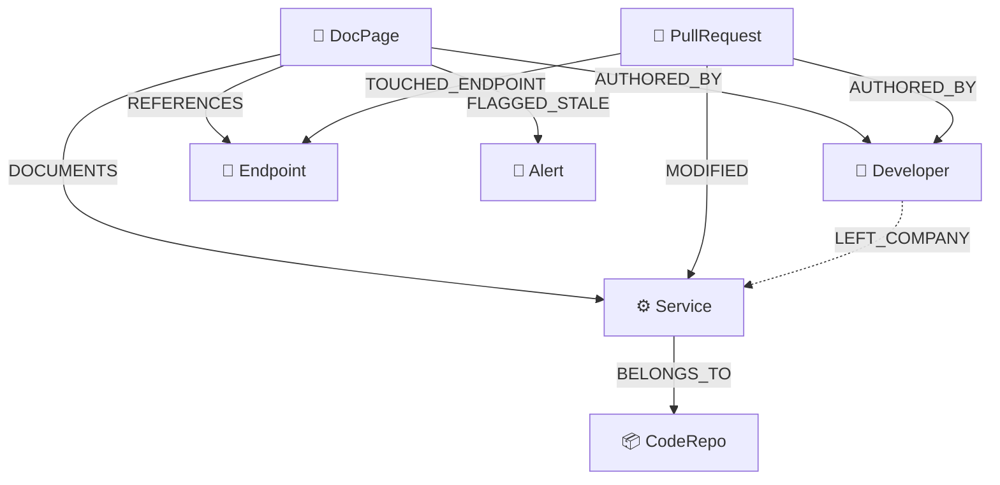
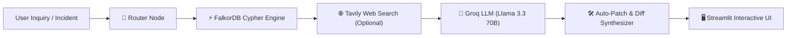

# 🛰️ DocuDrift / LivingWiki — Autonomous Knowledge Staleness & Drift Sentinel

> **Tagline:** *"The company wiki that knows when it's lying."*

[](https://www.falkordb.com/)
[](https://app.falkordb.cloud)
[](https://langchain-ai.github.io/langgraph/)
[](https://groq.com/)
[](https://streamlit.io/)
[](https://www.docker.com/)

---

## 📌 Overview & The Problem

Internal company documentation (Notion, Confluence, internal Markdown runbooks) starts decaying the day it is written. While software engineers ship pull requests daily, documentation is almost never updated in sync. As a result, engineers rely on obsolete deployment guides, run outdated scripts, or follow broken onboarding instructions.

When an engineer asks an AI assistant or internal wiki how to deploy a service:
* ❌ **Traditional Static Wiki:** *"Run `./deploy.sh --env=production` and call `POST /v1/charge`."*  
* 💥 **Production Reality:** `./deploy.sh` was deleted in PR #310 in favor of Docker Compose, and `/v1/charge` was deprecated in favor of `/v2/checkout`. The deployment crashes.

**DocuDrift** eliminates this disconnect by continuously synchronizing code pull requests, API endpoints, microservices, developers, and documentation into a **live, multi-hop knowledge graph in FalkorDB**.

---

## 🏆 Hackathon Tracks Targeted

DocuDrift was designed specifically for the **[FalkorDB Graph Hacks Hackathon](https://www.wemakedevs.org/hackathons/falkordb)**:

### 🕵️ Track 01: Agents That Act on Connected Data
* **Multi-hop reasoning across code and knowledge:** Evaluates how code modifications in pull requests ripple into API contracts and documentation pages.
* **Graph algorithms as agent tools:** Cypher queries calculate drift velocity dynamically:
  $$\text{Drift Score} = (\text{Merged PRs} \times 15) + (\text{Modified Endpoints} \times 20)$$
* **Explainable drift alerts & blast radius:** When an endpoint changes, the agent traverses the graph to trace the exact blast radius to every impacted doc page, section, and microservice.
* **Automated unified git diff generation:** Generates unified patches ready for 1-click GitHub pull request submission.

### 🧠 Track 03: Company Brain
* **Enterprise knowledge graph ontology:** Unifies people, services, endpoints, repositories, documents, and code decisions into a single connected graph.
* **Orphaned knowledge & bus factor sentinel:** When an engineer leaves or switches teams (`[:LEFT_COMPANY]`), the agent identifies all systems and docs where they were the sole author/maintainer (*"3 critical system docs now have 0 active maintainers"*).
* **Algorithmic maintainer discovery:** Recommends active engineers to take over ownership based on their recent PR contribution velocity to that service.
* **Decision traceability:** Traces any instruction back to the exact PR and author responsible for the change.

### 🤖 Track 02 (Bonus): Agent Memory & Multi-Agent Coordination
* Stateful LangGraph multi-agent architecture with intent router, Cypher retrieval engine, Tavily web verification, and Groq Llama 3.3 70B synthesis.

---

## 🏛️ FalkorDB Graph Architecture & Schema

### Node Entities
| Label | Description | Key Properties |
|---|---|---|
| `DocPage` | Technical runbook, guide, or wiki article | `id`, `title`, `url`, `last_updated`, `content`, `category` |
| `Service` | Microservice or application tier | `id`, `name`, `tier`, `repo_url`, `description` |
| `Endpoint` | API endpoint or RPC method | `id`, `path`, `method`, `deprecated`, `current_status` |
| `Developer` | Engineer or team member | `id`, `name`, `email`, `role`, `status` (`active`/`inactive`) |
| `PullRequest` | Code merge event / commit diff | `id`, `number`, `title`, `merged_at`, `diff_summary`, `files_changed` |
| `Alert` | Drift or staleness notification | `id`, `doc_id`, `reason`, `severity`, `suggested_patch` |
| `CodeRepo` | Git repository | `id`, `name`, `url`, `default_branch` |

### Relationship Graph


---

## 🤖 Multi-Agent Workflow (LangGraph + Groq + Tavily)



1. **Router Node:** Identifies user intent (`drift_audit`, `orphan_check`, `qna`, `blast_radius`, `patch_request`).
2. **FalkorDB Cypher Engine:** Executes multi-hop queries across code modifications and document references.
3. **Tavily Search Node:** Verifies external industry standards (e.g. verifying Docker Compose syntax, TLS specs).
4. **Groq LLM Node:** Synthesizes context into an explainable response and formats a unified git diff.

---

## 🔍 Core Cypher Queries in Action

### 1. Drift Velocity & Staleness Detection
```cypher
MATCH (doc:DocPage)-[:DOCUMENTS]->(s:Service)
OPTIONAL MATCH (pr:PullRequest)-[:MODIFIED]->(s)
OPTIONAL MATCH (doc)-[:REFERENCES]->(ep:Endpoint)<-[:TOUCHED_ENDPOINT]-(pr_ep:PullRequest)
WITH doc, s,
     count(DISTINCT pr) AS service_prs,
     count(DISTINCT pr_ep) AS endpoint_prs
RETURN doc.id AS doc_id,
       doc.title AS doc_title,
       doc.last_updated AS last_updated,
       s.name AS service_name,
       service_prs AS pr_count,
       endpoint_prs AS endpoint_pr_count,
       (service_prs * 15 + endpoint_prs * 20) AS drift_score
ORDER BY drift_score DESC
```

### 2. Orphaned Knowledge & Bus Factor Sentinel
```cypher
MATCH (doc:DocPage)-[:AUTHORED_BY]->(author:Developer)
WHERE author.status = 'inactive'
MATCH (doc)-[:DOCUMENTS]->(s:Service)
OPTIONAL MATCH (doc)-[:AUTHORED_BY]->(other:Developer)
WHERE other.status = 'active'
WITH doc, s, author, count(other) AS active_coauthors
WHERE active_coauthors = 0
RETURN doc.title AS doc_title, s.name AS service_name, author.name AS departed_author
```

### 3. Algorithmic Maintainer Recommendation
```cypher
MATCH (s:Service {name: $service_name})<-[:MODIFIED]-(pr:PullRequest)-[:AUTHORED_BY]->(dev:Developer)
WHERE dev.status = 'active'
RETURN dev.name AS candidate_name, count(pr) AS recent_prs_merged
ORDER BY recent_prs_merged DESC LIMIT 3
```

### 4. Blast Radius Impact Analysis
```cypher
MATCH (pr:PullRequest {number: $pr_number})-[:TOUCHED_ENDPOINT]->(ep:Endpoint)
OPTIONAL MATCH (doc:DocPage)-[:REFERENCES]->(ep)
RETURN ep.path AS endpoint, collect(DISTINCT doc.title) AS affected_docs
```

---

## ⚡ Quickstart Guide

DocuDrift can connect to a **FalkorDB Cloud** instance, a **Local Docker** container, or run seamlessly on its built-in **In-Memory Standby Engine** (no database setup required to test).

### 1. Prerequisites
- Python 3.10 or higher
- Git
- *(Optional)* Docker Desktop or FalkorDB Cloud account

### 2. Installation
```bash
# Clone repository
git clone https://github.com/your-username/docudrift.git
cd docudrift

# Create virtual environment
python -m venv venv

# Activate virtual environment
.\venv\Scripts\activate      # Windows (PowerShell/CMD)
# source venv/bin/activate    # macOS / Linux

# Install dependencies
pip install -r requirements.txt
```

### 3. Database Configuration (`.env`)
Create a `.env` file in the root folder (or copy `.env.example`):

#### Option A: FalkorDB Cloud (Recommended for Cloud Demos)
```env
FALKORDB_HOST=your-instance.falkordb.cloud
FALKORDB_PORT=6379
FALKORDB_PASSWORD=your_cloud_password
FALKORDB_USERNAME=falkordb
FALKORDB_GRAPH_NAME=DocuDrift

# Free key at https://console.groq.com
GROQ_API_KEY=your_groq_api_key_here
GROQ_MODEL=llama-3.3-70b-versatile

# Optional Tavily search key: https://tavily.com
TAVILY_API_KEY=your_tavily_api_key
```

#### Option B: Local FalkorDB via Docker
```bash
docker compose up -d
```
And set your `.env`:
```env
FALKORDB_HOST=localhost
FALKORDB_PORT=6379
FALKORDB_PASSWORD=
FALKORDB_GRAPH_NAME=DocuDrift
```

#### Option C: Instant In-Memory Standby
If you haven't started Docker or FalkorDB Cloud yet, DocuDrift automatically runs on its **embedded in-memory standby engine** with sub-millisecond query performance!

### 4. Launch Application
Double-click `run.bat` or run:
```bash
streamlit run ui/app.py
```
Open **`http://localhost:8501`** in your browser.

---

## 🖥️ Streamlit Dashboard Feature Tour

| Tab | Feature | Description |
|---|---|---|
| **🛰️ 1. Drift Radar** | Live Telemetry & Metrics | Real-time drift scores, PR count velocity, critical drift flags, and interactive distribution charts. |
| **🕸️ 2. Knowledge Graph** | Interactive Visualizer | Physics-based PyVis graph visualization with color-coded nodes, zoom/pan, and relationship inspection. |
| **💬 3. AI Sentinel** | Conversational Auto-Patcher | Ask questions about services or deployments; the agent discovers stale instructions, cites PRs, and generates a unified git patch. |
| **👤 4. Bus Factor** | Knowledge Orphanage | Identifies critical documentation left behind by departed engineers and recommends active maintainers. |
| **💥 5. Blast Radius** | PR & API Impact Analyzer | Input any pull request number (e.g. `315`) to trace downstream impact on endpoints, microservices, and documentation. |
| **🛠️ 6. Cypher Console** | Interactive Graph Playground | Run raw Cypher queries directly against FalkorDB with tabular and JSON output. |

---

## 🧪 Pre-Seeded Hackathon Demo Scenarios

DocuDrift ships with an enterprise dataset simulating **Acme Corp's** microservice architecture:

1. **`PaymentGateway` Deployment Drift:**
   * **Stale Doc:** Guide (94 days old) still tells engineers to run `./deploy.sh` and hit `POST /v1/charge`.
   * **Ground Truth:** PR #310 deleted `./deploy.sh` for Docker Compose, and PR #315 deprecated `/v1/charge` in favor of `/v2/checkout`.
   * **Agent Action:** When asked *"How do I deploy PaymentGateway?"*, the agent flags the doc as stale, explains the discrepancy, and outputs a ready-to-merge Markdown patch.
2. **`NotificationWorker` Orphaned Knowledge (Bus Factor = 0):**
   * **Scenario:** Lead author **Bob Miller** has left Acme Corp (`[:LEFT_COMPANY]`).
   * **Agent Action:** Flags `NotificationWorker` documentation as orphaned with 0 active co-authors, and recommends **Diana Prince** based on her recent PR contributions.
3. **`AuthService` Protocol Upgrade:**
   * **Scenario:** Documentation specifies legacy HS256 JWT tokens with 24-hour expiration. PR #280 upgraded auth to RS256 with 15-minute expiration for compliance.
   * **Agent Action:** Auto-detects configuration staleness and alerts the security operations team.

---

## 📁 Repository Structure

```text
docudrift/
├── agent/
│   ├── tools.py          # Agent tools: Cypher execution, staleness scoring, blast radius
│   └── workflow.py       # LangGraph multi-agent state graph & Groq LLM integration
├── graph/
│   ├── connection.py     # Resilient FalkorDB connection manager (Cloud SSL + fallback)
│   ├── queries.py        # Optimized Cypher query catalog
│   ├── schema.py         # Graph entity schema & relationship definitions
│   └── seeder.py         # Enterprise Acme Corp knowledge graph seeder
├── ui/
│   ├── app.py            # Streamlit multi-tab sentinel dashboard
│   └── components.py     # PyVis interactive physics graph renderer
├── .env.example          # Environment variable template
├── docker-compose.yml    # One-click FalkorDB local container definition
├── requirements.txt      # Python dependencies
├── run.bat               # Windows one-click launcher
└── README.md             # Project documentation
```

---

## 📜 License & Credits

Built with ❤️ for the **FalkorDB Graph Hacks Hackathon 2026**.  
Licensed under the **MIT License**.
